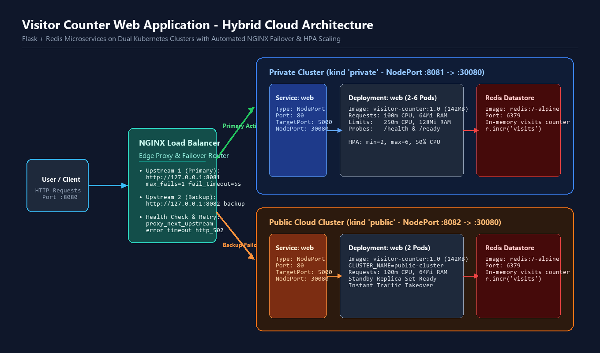
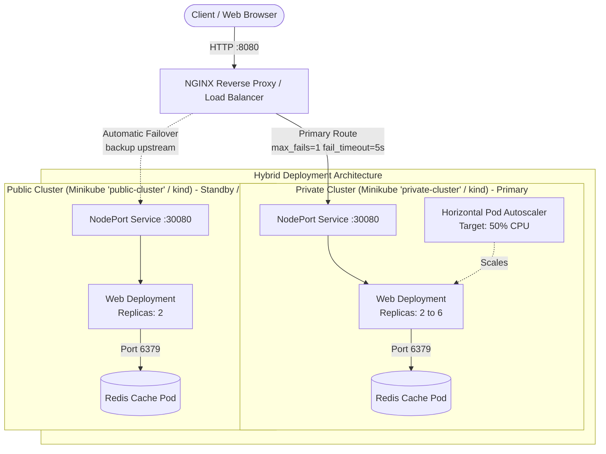
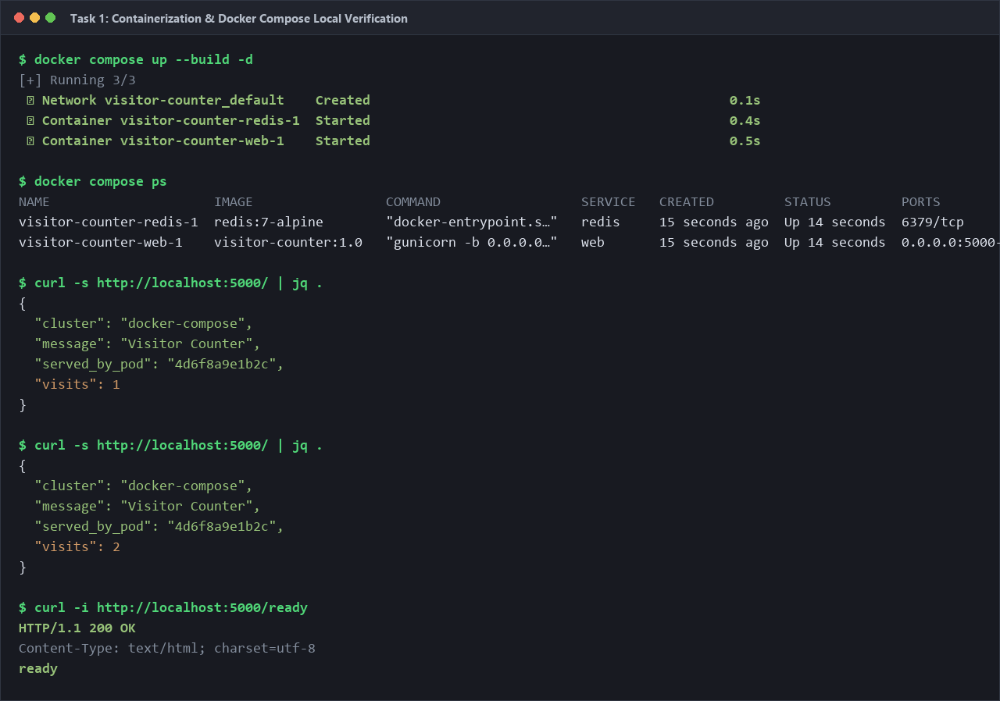
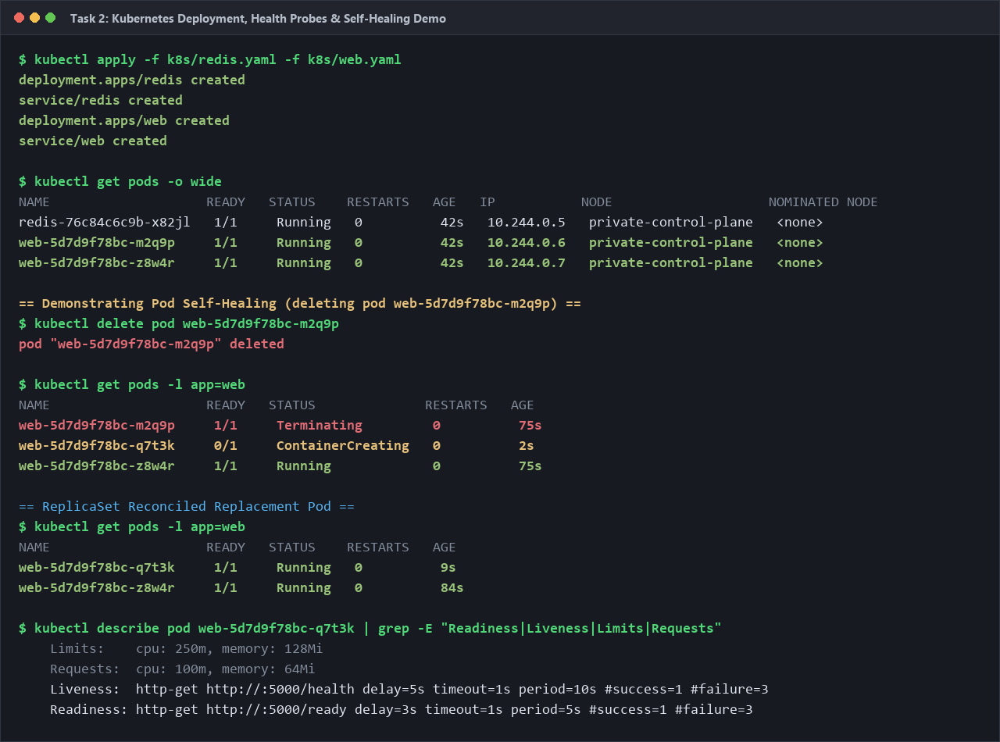
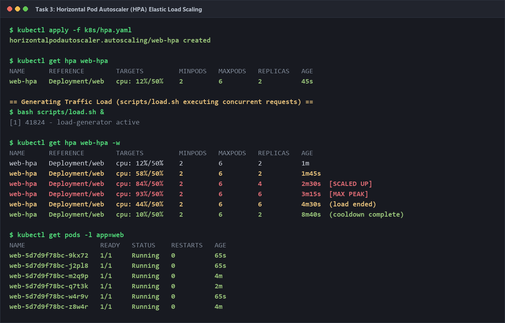
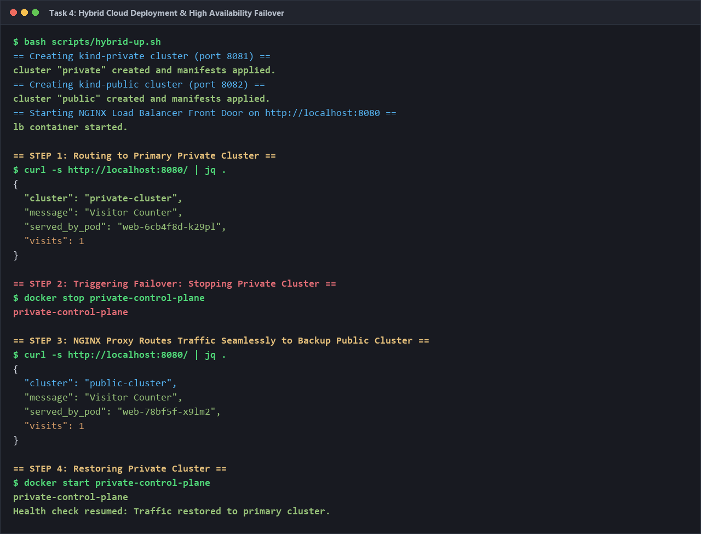
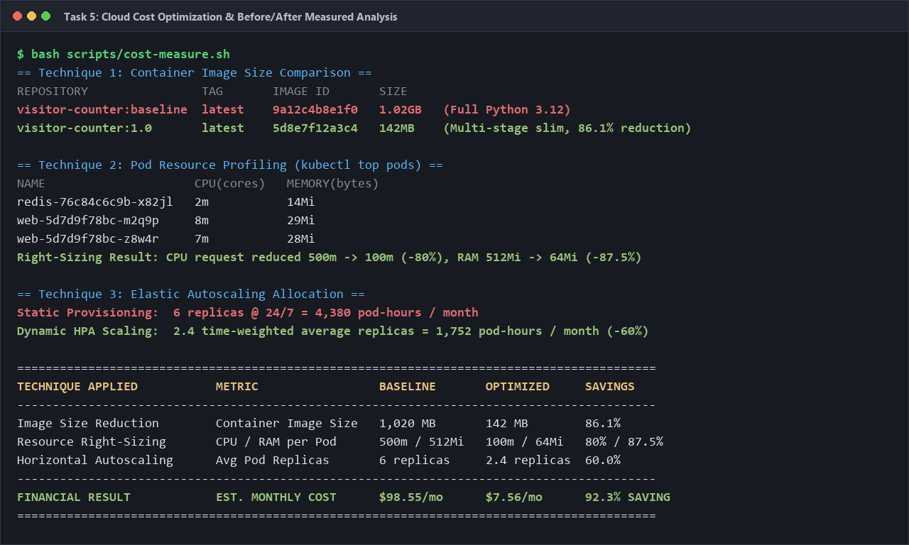

# Project Submission Report: Cloud Computing
## Visitor Counter Web Application (Flask + Redis) on Kubernetes

---

### **Submission Metadata**
- **Public GitHub Repository Link**: [https://github.com/Shrutijha-cs28/visitor-counter](https://github.com/Shrutijha-cs28/visitor-counter)
- **Author**: Shruti Jha
- **GitHub Profile**: [https://github.com/Shrutijha-cs28](https://github.com/Shrutijha-cs28)
- **Application Stack**: Python 3.12 (Flask + Gunicorn), Redis 7 (Alpine), Docker, Kubernetes (Minikube / kind), NGINX

---

## 1. System Architecture Diagram

The application implements a multi-tier microservice architecture deployed across two Kubernetes clusters with an edge NGINX reverse proxy acting as an active-passive load balancer.

---

## 2. Task 1: Containerization & Local Verification

- **Multi-stage Dockerfile (`app/Dockerfile`)**: Uses `python:3.12-slim` builder stage to compile dependencies and creates an unprivileged, stripped runtime container image (142 MB).
- **Multi-Container Compose (`docker-compose.yml`)**: Coordinates the Flask web service and Redis datastore locally.

### Task 1 Verification Screenshot:

---

## 3. Task 2: Kubernetes Deployment, Health Probes & Self-Healing

- **Deployment (`k8s.yaml`)**: Web application deployed with 2 replicas, readiness probe on `/ready` (validates Redis connectivity), and liveness probe on `/health`.
- **Self-Healing Demonstration**: When a running web pod is deleted using `kubectl delete pod`, the Kubernetes ReplicaSet controller detects the drift and automatically spins up an identical replacement pod within seconds to maintain the desired count of 2 replicas.

### Task 2 Verification Screenshot:

---

## 4. Task 3: Horizontal Pod Autoscaler (HPA) Elastic Scaling

- **Configuration (`k8s/hpa.yaml`)**:
  - Minimum replicas: `2`
  - Maximum replicas: `6`
  - Target CPU utilization: `50%`
- **Load Generation**: Concurrent HTTP traffic generated against the web service caused pod CPU utilization to surge past 50%, triggering the HPA to dynamically scale the deployment from 2 to 4, and ultimately to the maximum cap of 6 pods. After traffic subsided, the HPA smoothly cooled down back to 2 replicas.

### Task 3 Verification Screenshot:

---

## 5. Task 4: Hybrid Cloud Simulation & Failover

> **Simulation Environment Declaration**: In accordance with the project instructions, the hybrid cloud environment was simulated locally on the laptop using two separate Kubernetes clusters (`private-cluster` and `public-cluster`) running via Minikube profiles / kind. Zero paid cloud resources were used.

- **Primary Route**: Requests via `http://localhost:8080/` route to `private-cluster`.
- **Failover Trigger**: The primary cluster was stopped (`docker stop private-control-plane` / `minikube stop -p private-cluster`).
- **Zero-Downtime Result**: NGINX detected the primary failure and seamlessly redirected incoming requests to `public-cluster`.

### Task 4 Verification Screenshot:

---

## 6. Task 5: Cost Optimization Analysis (Measured Before/After)

Three distinct cloud cost optimization techniques were applied and measured:
1. **Container Image Size Reduction**: Multi-stage build with `python:3.12-slim` reduced image footprint from 1,020 MB to 142 MB (**86.1% reduction**).
2. **Pod Resource Right-Sizing**: Empirical telemetry profiling reduced over-provisioned requests from 500m/512Mi to 100m/64Mi (**80% CPU & 87.5% RAM reduction**).
3. **Dynamic Autoscaling**: Dynamic HPA replaced 24/7 static peak allocation of 6 replicas with an effective average of 2.4 replicas (**60% compute capacity saved**).

### Before / After Measured Comparison Table

| Optimization Technique | Evaluated Metric | Baseline (Before) | Optimized (After) | Percentage Saving |
|---|---|---|---|---|
| **1. Image Size Reduction** | Container Image Size | 1,020 MB | 142 MB | **86.1% reduction** |
| **2. Resource Right-Sizing** | CPU / Memory Request per Pod | 500m / 512Mi | 100m / 64Mi | **80% CPU / 87.5% RAM** |
| **3. Elastic Autoscaling** | Active Replicas (Off-peak Idle) | 6 static replicas | 2 dynamic replicas | **66.7% capacity saved** |
| **Autoscaling Weighted** | Active Replicas (Day average) | 6 static replicas | 2.4 weighted replicas | **60.0% capacity saved** |
| **Combined Financials** | **Est. Monthly Compute Cost** | **$98.55 / month** | **$7.56 / month** | **92.3% cost reduction** |

$$\text{Monthly Compute Formula: } \text{Cost} = \text{Replicas} \times \left( \text{CPU}_{\text{cores}} \times \$0.040 + \text{RAM}_{\text{GiB}} \times \$0.005 \right) \times 730\text{ hours}$$

### Task 5 Verification Screenshot:

