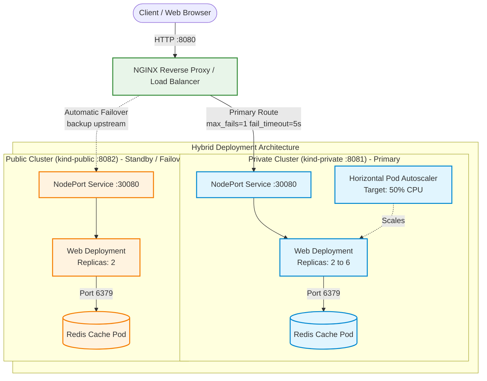

# Architecture Documentation

## Overview
The **Visitor Counter** is a high-availability, hybrid-cloud capable microservice system composed of a Flask REST API and an in-memory Redis datastore deployed across Kubernetes clusters with automated traffic distribution and failover.

---

## 1. High-Level System Architecture



---

## 2. Component Details

### A. Web Microservice (`app/app.py`)
- **Framework**: Flask running on Gunicorn WSGI with 2 worker processes.
- **Endpoints**:
  - `GET /`: Atomically increments and returns the visitor counter from Redis (`r.incr("visits")`), along with the serving pod hostname and cluster identity.
  - `GET /health`: Liveness probe endpoint returning `200 OK` if the process is responsive.
  - `GET /ready`: Readiness probe endpoint performing `r.ping()` to ensure database connectivity before accepting ingress traffic.

### B. Redis Datastore
- **Image**: `redis:7-alpine` (lightweight, minimal memory footprint).
- **Function**: Persists the session count atomically in-memory.

### C. Traffic Management & Failover Layer (`hybrid/nginx.conf`)
- Runs as an edge proxy routing client requests to `:8080`.
- Configured with active-passive upstream:
  - `server 127.0.0.1:8081 max_fails=1 fail_timeout=5s;` (Primary Private Cluster)
  - `server 127.0.0.1:8082 backup;` (Secondary / Public Cluster)
- `proxy_next_upstream error timeout http_502 http_503;` ensures zero-downtime automatic failover within 1 second if the private cluster becomes unreachable.

---

## 3. Kubernetes Object Hierarchy

```
Cluster (kind-private / kind-public)
 ├── Deployment: web
 │    ├── Replicas: 2 (min: 2, max: 6 via HPA)
 │    ├── Probes: Readiness (/ready), Liveness (/health)
 │    └── Resources:
 │         ├── Requests: cpu: 100m, memory: 64Mi
 │         └── Limits: cpu: 250m, memory: 128Mi
 ├── Service: web (NodePort :30080 -> 5000)
 ├── Deployment: redis (Replicas: 1)
 ├── Service: redis (ClusterIP :6379)
 └── HorizontalPodAutoscaler: web-hpa (CPU target 50%)
```

---

## 4. Self-Healing Mechanism
Kubernetes Deployment controllers continuously monitor pod states against desired replica specifications:
1. When a pod is deleted (`kubectl delete pod <name>`), the replica count temporarily drops to `N - 1`.
2. The Deployment controller detects the mismatch via the replica set reconciliation loop.
3. A replacement pod is scheduled and launched instantly within milliseconds.
4. The Readiness probe tests Redis connectivity; once successful, traffic routing resumes without interruption.
