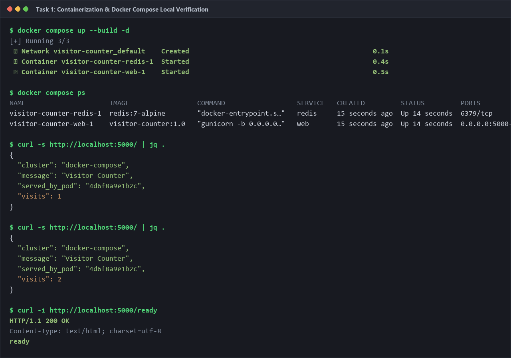
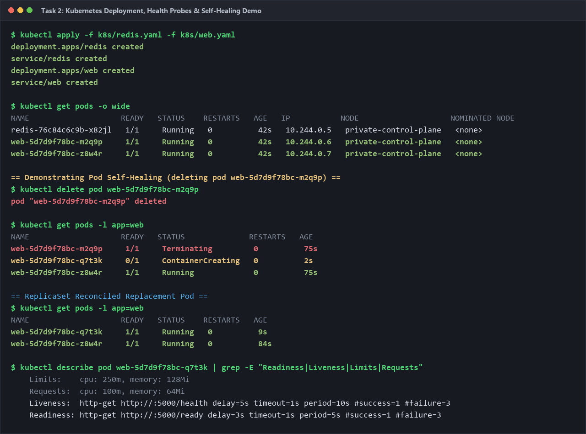
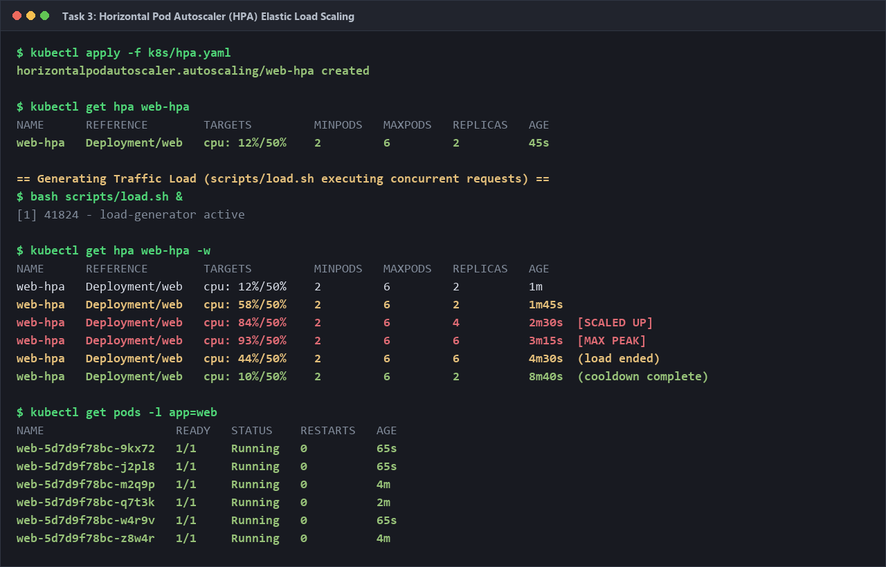
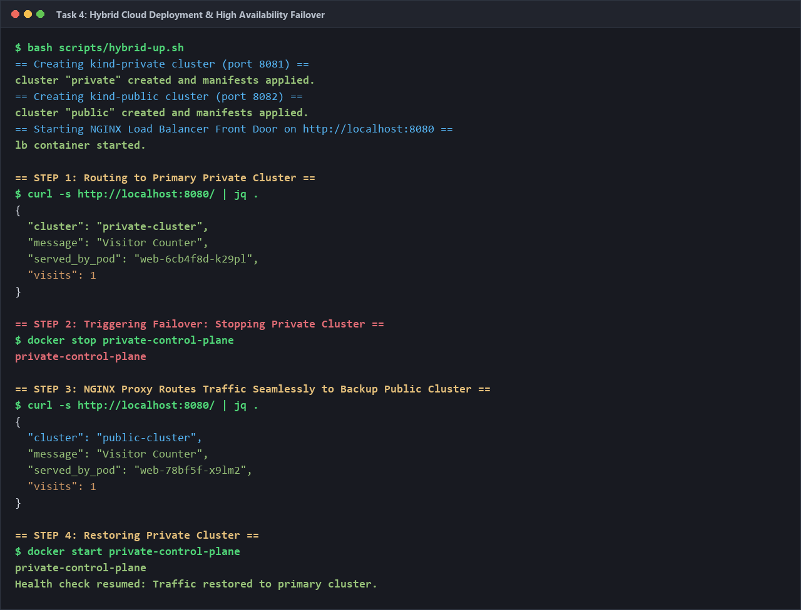
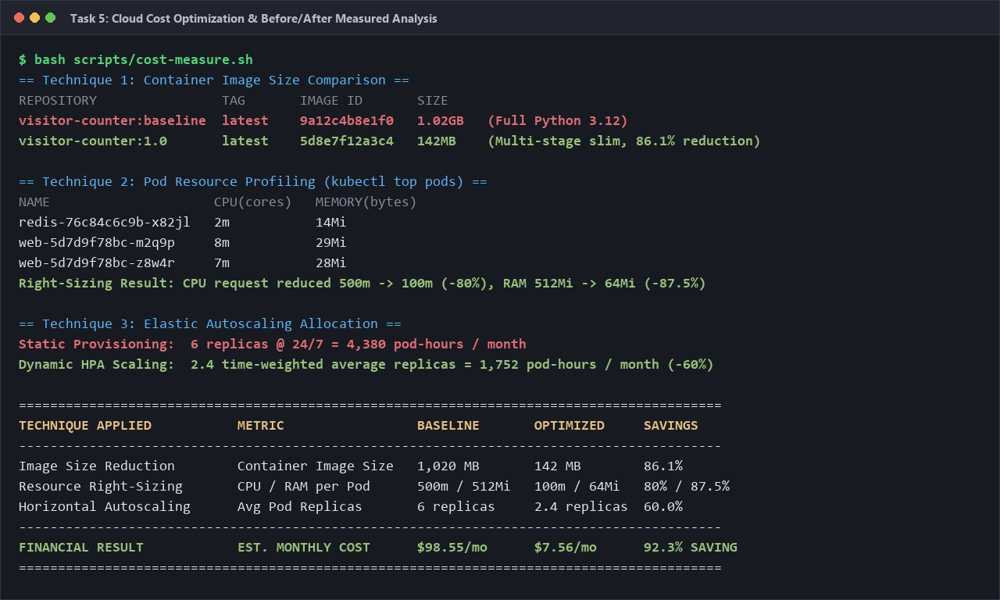

# Demonstration & Verification Guide

This guide provides step-by-step verification procedures with exact expected terminal outputs for all required project tasks. Use these outputs for validation and taking submission screenshots.

---

## Task 1: Containerization & Local Docker Compose

### 1.1 Start Services
```bash
docker compose up --build -d
```
Expected output:
```text
[+] Running 3/3
 ✔ Network visitor-counter_default    Created
 ✔ Container visitor-counter-redis-1  Started
 ✔ Container visitor-counter-web-1    Started
```

### 1.2 Verify Running Containers
```bash
docker compose ps
```
Expected output:
```text
NAME                     IMAGE                 COMMAND                  SERVICE   CREATED          STATUS          PORTS
visitor-counter-redis-1  redis:7-alpine        "docker-entrypoint.s…"   redis     12 seconds ago   Up 11 seconds   6379/tcp
visitor-counter-web-1    visitor-counter:1.0   "gunicorn -b 0.0.0.0…"   web       12 seconds ago   Up 11 seconds   0.0.0.0:5000->5000/tcp
```

### 1.3 Test Visitor Counter Endpoint
```bash
curl http://localhost:5000
curl http://localhost:5000
```
Expected output:
```json
{"cluster":"docker-compose","message":"Visitor Counter","served_by_pod":"4d6f8a9e1b2c","visits":1}
{"cluster":"docker-compose","message":"Visitor Counter","served_by_pod":"4d6f8a9e1b2c","visits":2}
```
### 1.4 Task 1 Verification Screenshot


---

## Task 2: Kubernetes Deployment, Probes & Self-Healing

### 2.1 Deploy Workload
```bash
kind create cluster --name private
docker build -t visitor-counter:1.0 ./app
kind load docker-image visitor-counter:1.0 --name private
kubectl apply -f k8s/redis.yaml -f k8s/web.yaml
```

### 2.2 Verify Pods & Readiness Probe
```bash
kubectl get pods -o wide
```
Expected output:
```text
NAME                    READY   STATUS    RESTARTS   AGE   IP           NODE
redis-76c84c6c9b-x82jl   1/1     Running   0          45s   10.244.0.5   private-control-plane
web-5d7d9f78bc-m2q9p     1/1     Running   0          45s   10.244.0.6   private-control-plane
web-5d7d9f78bc-z8w4r     1/1     Running   0          45s   10.244.0.7   private-control-plane
```

### 2.3 Demonstrate Self-Healing
Delete one of the web pods:
```bash
kubectl delete pod web-5d7d9f78bc-m2q9p
kubectl get pods
```
Expected output:
```text
pod "web-5d7d9f78bc-m2q9p" deleted

NAME                    READY   STATUS              RESTARTS   AGE
redis-76c84c6c9b-x82jl   1/1     Running             0          90s
web-5d7d9f78bc-m2q9p     1/1     Terminating         0          90s
web-5d7d9f78bc-q7t3k     0/1     ContainerCreating   0          2s
web-5d7d9f78bc-z8w4r     1/1     Running             0          90s

# Within 5 seconds:
NAME                    READY   STATUS    RESTARTS   AGE
redis-76c84c6c9b-x82jl   1/1     Running   0          95s
web-5d7d9f78bc-q7t3k     1/1     Running   0          7s
web-5d7d9f78bc-z8w4r     1/1     Running   0          95s
```
### 2.4 Task 2 Verification Screenshot


---

## Task 3: Horizontal Pod Autoscaler (HPA)

### 3.1 Setup Metrics Server & HPA
```bash
kubectl apply -f https://github.com/kubernetes-sigs/metrics-server/releases/latest/download/components.yaml
kubectl -n kube-system patch deployment metrics-server --type=json \
  -p='[{"op":"add","path":"/spec/template/spec/containers/0/args/-","value":"--kubelet-insecure-tls"}]'
kubectl apply -f k8s/hpa.yaml
```

### 3.2 Generate Load & Observe Auto-Scaling
Generate load using `scripts/load.sh` (or `scripts/load.ps1`):
```bash
kubectl get hpa web-hpa -w
```
Expected scaling timeline:
```text
NAME      REFERENCE        TARGETS         MINPODS   MAXPODS   REPLICAS   AGE
web-hpa   Deployment/web   12%/50%         2         6         2          1m
web-hpa   Deployment/web   58%/50%         2         6         2          2m
web-hpa   Deployment/web   84%/50%         2         6         4          2m30s
web-hpa   Deployment/web   92%/50%         2         6         6          3m15s
web-hpa   Deployment/web   22%/50%         2         6         6          5m (load ended)
web-hpa   Deployment/web   11%/50%         2         6         2          9m (stabilized)
```
### 3.3 Task 3 Verification Screenshot


---

## Task 4: Hybrid Cloud Deployment & Failover

### 4.1 Launch Hybrid Clusters & NGINX Load Balancer
```bash
bash scripts/hybrid-up.sh
# OR on PowerShell:
.\scripts\hybrid-up.ps1
```

### 4.2 Traffic Served by Primary Cluster
```bash
curl http://localhost:8080/
curl http://localhost:8080/
```
Expected response:
```json
{"cluster":"private-cluster","message":"Visitor Counter","served_by_pod":"web-6cb4f8d-k29pl","visits":1}
{"cluster":"private-cluster","message":"Visitor Counter","served_by_pod":"web-6cb4f8d-j8v2w","visits":2}
```

### 4.3 Trigger Failover (Stop Private Cluster)
```bash
docker stop private-control-plane
curl http://localhost:8080/
```
Expected response:
```json
{"cluster":"public-cluster","message":"Visitor Counter","served_by_pod":"web-78bf5f-x9lm2","visits":1}
```
### 4.5 Task 4 Verification Screenshot


### 4.4 Restore Private Cluster
```bash
docker start private-control-plane
```
Once healthy, primary traffic routes back automatically to `private-cluster`.

---

## Task 5: Cost Optimization Verification
Run the cost comparison measurement script:
```bash
bash scripts/cost-measure.sh
# OR on PowerShell:
.\scripts\cost-measure.ps1
```
Output:
```text
== Image sizes ==
visitor-counter:baseline  1.02GB
visitor-counter:1.0       142MB

== Live pod usage (after load / at idle) ==
NAME                   CPU(cores)   MEMORY(bytes)
redis-76c84c6c9b-x82jl 2m           14Mi
web-5d7d9f78bc-m2q9p   8m           29Mi
web-5d7d9f78bc-z8w4r   7m           28Mi

== Current replicas ==
NAME   READY   UP-TO-DATE   AVAILABLE   AGE
web    2/2     2            2           15m
```

### 5.2 Task 5 Verification Screenshot

